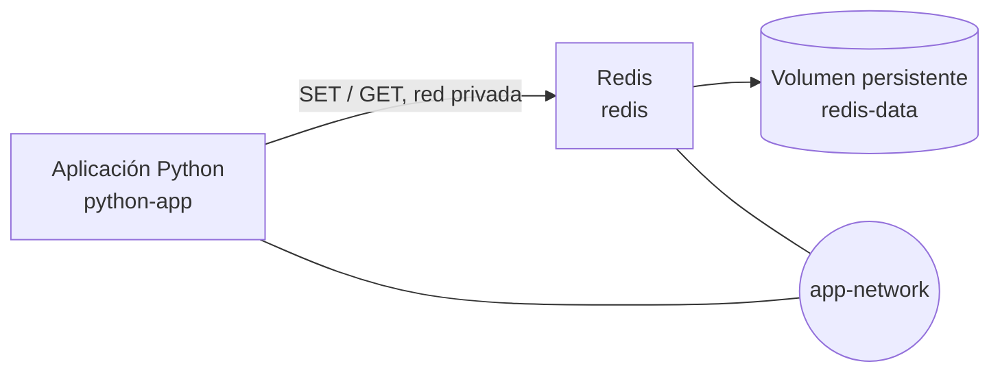

# Entrega 1: Integración continua con Docker

Proyecto académico que demuestra una aplicación Python conectada a Redis mediante Docker Compose. La aplicación escribe un valor en Redis y lo lee de nuevo; Redis conserva sus datos en un volumen nombrado.

## Componentes

- **Aplicación:** Python 3.12, imagen basada en `python:3.12-slim`, ejecutada con un usuario sin privilegios de root.
- **Segundo servicio:** Redis 7.4 Alpine, protegido con contraseña y con persistencia AOF.
- **Orquestación:** Docker Compose, red propia `app-network`, espera a que Redis esté saludable antes de iniciar la aplicación y volumen `redis-data`.
- **Integración continua:** GitHub Actions valida Compose y construye la imagen de la aplicación en cada push y pull request a `main` o `master`.

## Diagrama



## Requisitos

- Docker Desktop o Docker Engine con Docker Compose v2.
- Git (para clonar el repositorio).

## Ejecución local

1. Clona el repositorio y entra en su carpeta.
2. Copia `.env.example` como `.env` y cambia `REDIS_PASSWORD` por una clave local propia. `.env` está excluido del repositorio.
3. Construye e inicia la aplicación:

   ```bash
   docker compose up --build
   ```

La salida debe mostrar una línea de escritura y otra de lectura con el mismo valor. La aplicación termina tras la comprobación; Redis continúa ejecutándose.

Para volver a ejecutar la prueba sin reiniciar Redis:

```bash
docker compose run --rm python-app
```

## Comprobaciones y evidencias

Los pasos, comandos y resultados de la prueba se documentan en [`docs/evidencias.md`](docs/evidencias.md). Para revisar los contenedores, la red y el volumen:

```bash
docker compose ps
docker network ls
docker network inspect <nombre_del_proyecto>_app-network
docker volume inspect <nombre_del_proyecto>_redis-data
```

El prefijo de red y volumen se deriva del nombre del proyecto Compose. Consulta el nombre real con `docker network ls` y `docker volume ls`; en la ejecución documentada en `docs/evidencias.md`, el proyecto se llama `proyectogit`.

## GitHub Actions

El workflow está en [`.github/workflows/ci.yml`](.github/workflows/ci.yml). Puedes consultar cada ejecución en la pestaña **Actions** del repositorio. El workflow valida la configuración, descarga Redis y construye la imagen de Python; no publica imágenes en un registro.

## Archivos de configuración

- `.env.example`: variables necesarias para desarrollo local; no contiene secretos de producción.
- `.dockerignore`: excluye credenciales y archivos locales del contexto de construcción.
- `.gitignore`: evita versionar `.env`, entornos virtuales y cachés.
- `docker-compose.yml`: servicios, red, volumen, autenticación y comprobación de salud.

## Referencias

- [Docker Compose: servicios y redes](https://docs.docker.com/compose/)
- [Dockerfile: buenas prácticas](https://docs.docker.com/build/building/best-practices/)
- [Redis: persistencia](https://redis.io/docs/latest/operate/oss_and_stack/management/persistence/)
- [GitHub Actions](https://docs.github.com/actions)
