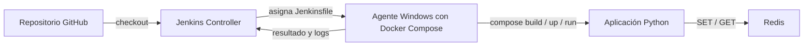
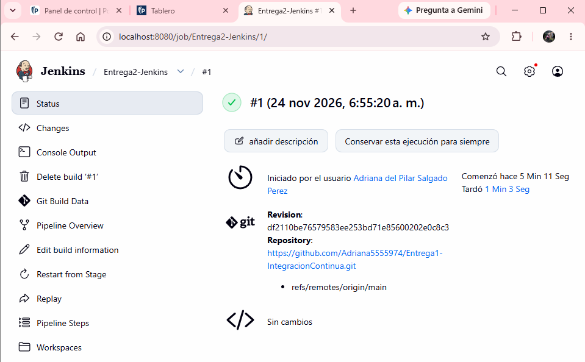
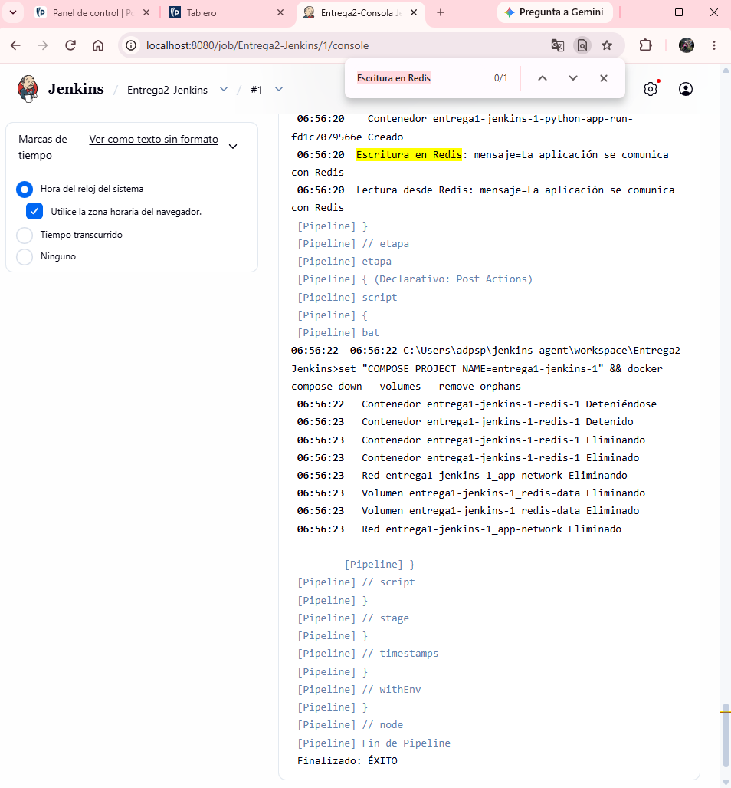
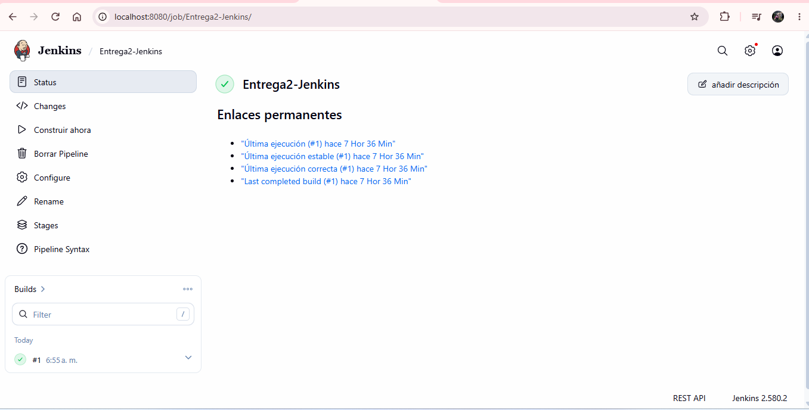
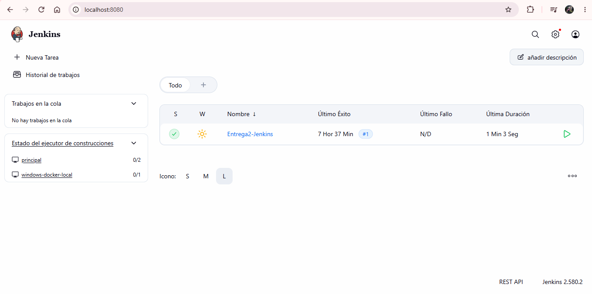
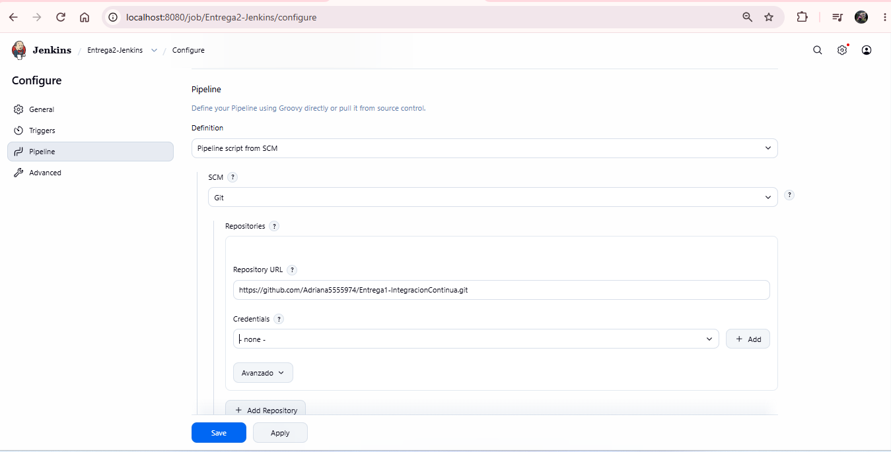
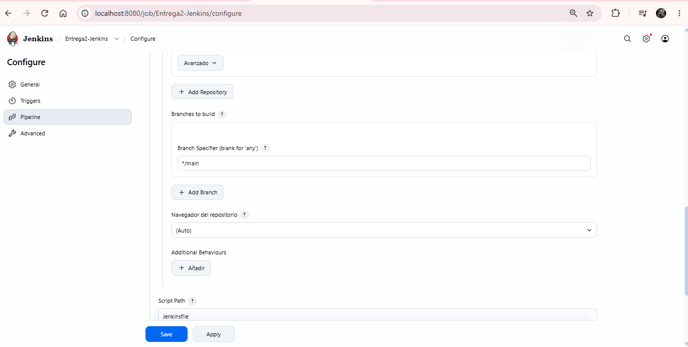

# Entrega 2: Jenkins como gestor de operaciones

## Objetivo

Integrar Jenkins al proyecto Python–Redis para automatizar la validación de Docker Compose, la construcción de la imagen de la aplicación y una prueba real de comunicación con Redis. La definición del proceso se guarda en `Jenkinsfile` junto con el código fuente.

La integración de GitHub Actions de la primera entrega se conserva. Jenkins sirve como segundo gestor de automatización y ejecuta el mismo flujo desde el repositorio.

## Arquitectura propuesta

- **Jenkins Controller:** administra proyectos, credenciales, historial y asignación de ejecuciones.
- **Agente `windows-docker`:** ejecuta los pasos del pipeline en Windows y debe tener Git, Docker Desktop, Docker Compose v2 y acceso al motor Docker.
- **Repositorio:** contiene el `Jenkinsfile`, la aplicación, Dockerfile y Compose.
- **Servicios de la prueba:** el pipeline levanta Redis y ejecuta la aplicación para confirmar una escritura y lectura reales.

Para un trabajo académico en un solo equipo, el controlador y el agente pueden residir en la misma máquina. En un despliegue más seguro, se recomienda mantener el controlador separado y ejecutar las tareas en un agente dedicado.

## Requisitos

- Windows 10/11 o Windows Server compatible con Docker Desktop/Engine en modo de contenedores Linux.
- Java 21 o posterior, requerido por versiones actuales de Jenkins.
- Jenkins LTS con los plugins sugeridos durante la configuración inicial; el plugin Pipeline viene incluido en la selección sugerida.
- Git disponible para Jenkins.
- Docker Desktop en ejecución, Docker Compose v2 y permisos del agente Jenkins para utilizar Docker.
- Conectividad de red desde Jenkins hacia GitHub.

La documentación oficial de Jenkins indica como mínimos 256 MB de RAM y 1 GB de espacio; para ejecutar Jenkins en Docker recomienda al menos 10 GB de almacenamiento. El uso real depende de la cantidad de ejecuciones, plugins y artefactos.

## Instalación y configuración

### 1. Instalar Jenkins

Instala una versión LTS compatible con Java 21. Si se usa la imagen oficial de Docker, se recomienda la etiqueta `jenkins/jenkins:lts-jdk21` y un volumen persistente montado en `/var/jenkins_home` para conservar la configuración y el historial al recrear el contenedor.

La interfaz web se utiliza por el puerto `8080`. No es necesario publicar el puerto `50000` en esta configuración de un solo equipo; ese puerto se usa para agentes inbound cuando se habilita ese tipo de conexión.

Durante el asistente inicial:

1. Desbloquea Jenkins con la contraseña inicial mostrada en los logs del servicio.
2. Instala los plugins sugeridos, incluido Pipeline.
3. Crea una cuenta administrativa propia.
4. Restringe la interfaz a localhost o a una red de confianza; no publiques Jenkins directamente en Internet.

### 2. Preparar el agente de ejecución

Configura un nodo Jenkins con la etiqueta `windows-docker`. El agente debe ejecutar procesos de Windows y tener Git, `docker` y `docker compose` disponibles en `PATH`. Comprueba también que la cuenta que ejecuta el agente puede acceder a Docker Desktop.

El agente necesita conectividad con el repositorio. Este proyecto es público, por lo que el checkout puede realizarse sin credenciales. Si el repositorio se vuelve privado, guarda un token de acceso de alcance mínimo en **Manage Jenkins → Credentials** y referencia el ID de esa credencial desde la configuración SCM. No escribas tokens en el `Jenkinsfile`.

### 3. Crear el pipeline desde el repositorio

1. En Jenkins, selecciona **New Item** y crea un proyecto **Pipeline**.
2. En la configuración del proyecto, selecciona **Pipeline script from SCM**.
3. Elige Git e introduce la URL del repositorio: `https://github.com/Adriana5555974/Entrega1-IntegracionContinua.git`.
4. Configura la rama `*/main` y la ruta del script `Jenkinsfile`.
5. Guarda y ejecuta **Build Now**.

Para ejecutar automáticamente al recibir cambios, configura un webhook desde GitHub hacia una URL Jenkins alcanzable y protegida. Para un Jenkins local no accesible desde Internet, utiliza **Poll SCM** o ejecución manual; no abras el servicio a Internet sin una configuración de acceso segura.

## Flujo del `Jenkinsfile`

El archivo `Jenkinsfile` define un pipeline declarativo:

1. **Checkout:** obtiene el commit desde GitHub.
2. **Validar y construir:** prepara `.env` a partir del ejemplo local, valida Compose y construye `python-app`.
3. **Prueba de integración:** levanta Redis, ejecuta la aplicación y verifica que el dato leído coincida con el escrito.
4. **Limpieza:** elimina los contenedores, redes y volúmenes creados para esa ejecución, incluso cuando una etapa falla.

Cada ejecución usa el nombre de proyecto Compose `entrega1-jenkins-<BUILD_NUMBER>` para aislar sus recursos. Se deshabilitan ejecuciones simultáneas para evitar que dos builds compartan el mismo workspace.

El agente Windows necesita permiso para ejecutar Docker. No se debe montar el socket/pipe de Docker a un controlador expuesto a usuarios no confiables: el acceso al motor Docker equivale a amplios privilegios sobre el host.

## Seguridad y mantenimiento

- Mantén Jenkins en una versión LTS soportada y actualiza el core y plugins con regularidad.
- Usa autenticación, permisos por rol y el principio de menor privilegio.
- Guarda secretos únicamente en Jenkins Credentials; evita imprimirlos en consola.
- No subas `.env`, contraseñas ni claves al repositorio.
- Limita el acceso de red al controlador y usa HTTPS/proxy seguro si se habilita acceso remoto.
- Conserva `/var/jenkins_home` en volumen persistente y respalda su contenido antes de actualizar o migrar Jenkins.
- El agente de este ejemplo ejecuta `docker compose down --volumes`; ese comando elimina el volumen de Redis creado por el pipeline para aislar la prueba. No se usa sobre el entorno de desarrollo del estudiante.

## Evidencias para la entrega

Agregar capturas reales a `docs/evidencias/` y enlazarlas aquí:

1. Jenkins instalado y página inicial con el usuario autenticado, sin mostrar contraseñas o tokens.
2. Configuración del pipeline mostrando SCM y ruta `Jenkinsfile`.
3. Build completado con todas las etapas en verde.
4. Consola de la etapa de integración mostrando escritura y lectura del mismo dato.
5. Historial de ejecuciones de Jenkins.

Las capturas deben corresponder a una ejecución real. No se incluyen resultados simulados.

### Ejecución exitosa del pipeline

### Prueba de comunicación con Redis

### Panel principal de Jenkins

### Historial de ejecuciones

### Configuración del pipeline desde GitHub

## Referencias oficiales

- [Instalación de Jenkins con Docker](https://www.jenkins.io/doc/book/installing/docker/)
- [Introducción a Jenkins Pipeline](https://www.jenkins.io/doc/book/pipeline/getting-started/)
- [Uso de un Jenkinsfile](https://www.jenkins.io/doc/book/pipeline/jenkinsfile/)
- [Credenciales en Jenkins](https://www.jenkins.io/doc/book/security/credentials/)
- [Seguridad de Jenkins](https://www.jenkins.io/doc/book/security/securing-jenkins/)
