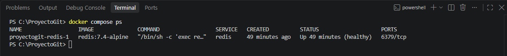
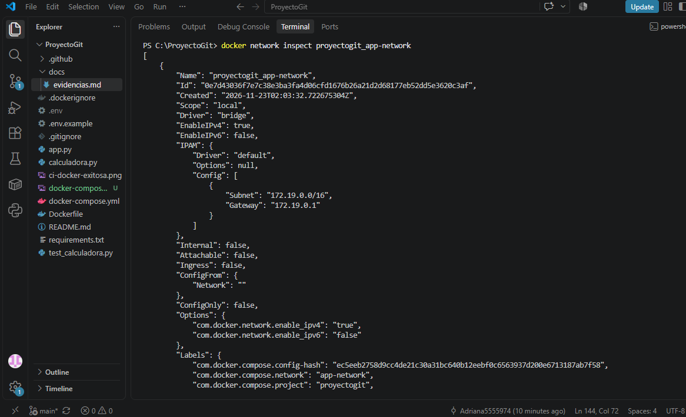
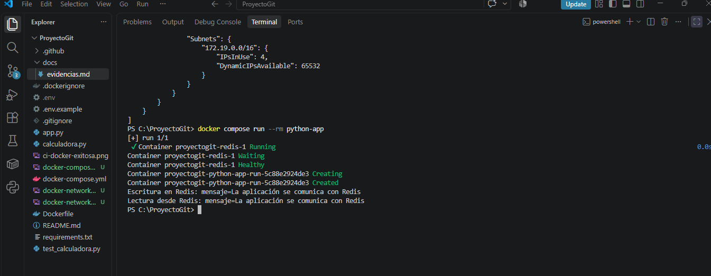
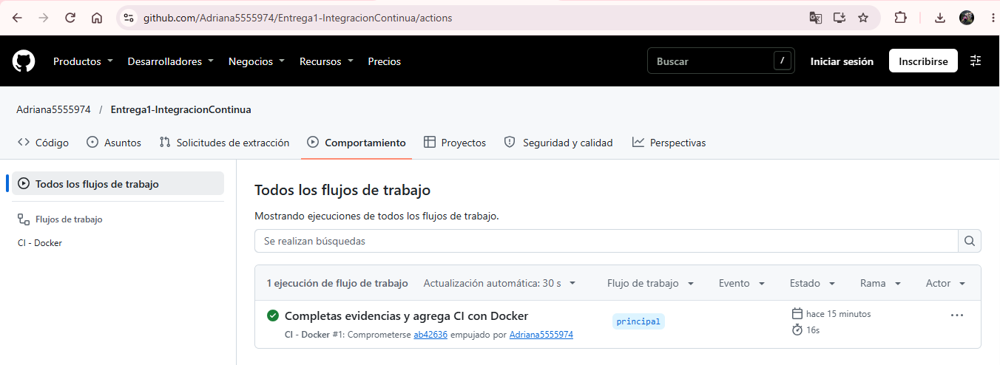

# Evidencias paso a paso

Se registran abajo los resultados reales compartidos desde una ejecución en Docker Compose con el nombre de proyecto `proyectogit`. La transcripción recibida sirve como evidencia de construcción y ejecución; añade capturas del terminal y de GitHub Actions al documento final de entrega.

## 1. Preparar variables y arrancar

En la carpeta raíz del repositorio:

```bash
cp .env.example .env
```

En Windows PowerShell, el equivalente es:

```powershell
Copy-Item .env.example .env
```

Edita `.env` y reemplaza `REDIS_PASSWORD` por una clave local. Luego ejecuta:

```bash
docker compose up --build
```

**Resultado observado** en `docker compose up --build -d`:

```text
Image proyectogit-python-app Built
Network proyectogit_app-network Created
Volume proyectogit_redis-data Created
Container proyectogit-redis-1 Healthy
Container proyectogit-python-app-1 Started
```

La ejecución de `docker compose run --rm python-app` produjo:

Salida esperada de la aplicación (el texto depende de `APP_MESSAGE`):

```text
Escritura en Redis: mensaje=La aplicación se comunica con Redis
Lectura desde Redis: mensaje=La aplicación se comunica con Redis
```

La aplicación confirma que el valor recuperado coincide con el escrito y finaliza con error si no coincide.

## 2. Confirmar los contenedores

Redis permanece activo después de la prueba. En otra terminal:

```bash
docker compose ps
```

**Resultado observado** en `docker compose ps`:

```text
NAME                  IMAGE              SERVICE   STATUS
proyectogit-redis-1   redis:7.4-alpine   redis     Up (healthy)
```

La aplicación es un proceso de una sola ejecución; por eso no aparece entre los servicios que continúan activos después de la prueba.



## 3. Confirmar la red propia

Consulta primero el nombre de red generado:

```bash
docker network ls
```

Después inspecciónala usando el nombre mostrado:

```bash
docker network inspect <nombre_de_red>
```

La salida compartida de `docker network inspect proyectogit_app-network` confirmó la red `bridge` y el subnet `172.19.0.0/16`:

```powershell
Name: proyectogit_app-network
Driver: bridge
Subnet: 172.19.0.0/16
Gateway: 172.19.0.1
Compose project: proyectogit
Compose network: app-network
Connected container: proyectogit-redis-1 (172.19.0.2/16)
```

La inspección se realizó después de que la aplicación terminara, así que solo Redis aparecía conectado en ese instante. Ambos servicios están configurados en `app-network` y la prueba real de escritura/lectura confirma la comunicación; la aplicación usa `redis` como host.

Para capturar los dos contenedores conectados simultáneamente, inicia temporalmente un proceso en el servicio de aplicación, inspecciona la red y luego elimina el proceso temporal:

```powershell
$appProbe = docker compose run -d --rm --entrypoint python python-app -c "import time; time.sleep(120)"
docker network inspect proyectogit_app-network
docker stop $appProbe
```

En la salida de `Containers` deben aparecer Redis y el contenedor temporal `python-app-run-*`. Esta comprobación complementa la prueba funcional anterior.



## 4. Confirmar persistencia del segundo servicio

Redis guarda sus datos en `/data`, utiliza AOF y conserva la información en el volumen nombrado `redis-data`.

La salida de `docker volume ls` confirmó que Compose creó el volumen:

```text
DRIVER    VOLUME NAME
local     proyectogit_redis-data
```

La inspección de `proyectogit_redis-data` confirmó su configuración:

```text
Name: proyectogit_redis-data
Driver: local
Scope: local
Compose project: proyectogit
Mountpoint: /var/lib/docker/volumes/proyectogit_redis-data/_data
```

Para comprobar la comunicación con Redis, ejecuta:

```powershell
docker compose run --rm python-app
```

La ejecución produjo:

```text
Escritura en Redis: mensaje=La aplicación se comunica con Redis
Lectura desde Redis: mensaje=La aplicación se comunica con Redis
```

La aplicación escribió el dato en Redis y luego leyó el mismo valor.



## 5. Confirmar el pipeline

Envía los cambios a GitHub y abre la pestaña **Actions** del repositorio. El workflow `CI - Docker` debe completarse correctamente en el push o pull request.

**Evidencia 6:** añade una captura del workflow en estado exitoso. El job valida la configuración de Compose, descarga Redis y construye la imagen de Python.

## Evidencias visuales 
